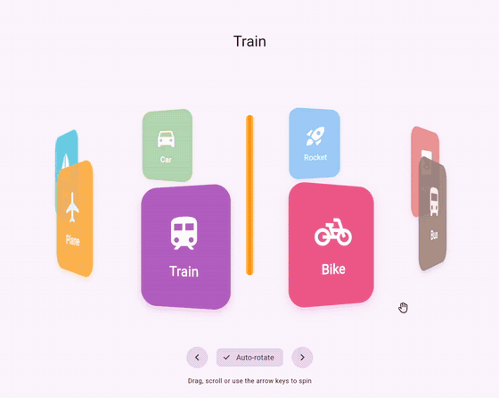
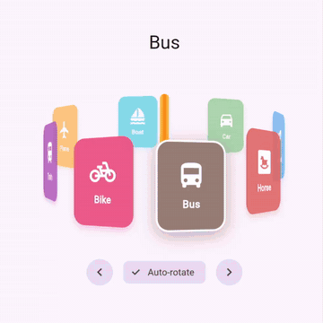

# merry_go_round_carousel

[](https://github.com/boffincoders/merry_go_round_carousel/actions/workflows/ci.yml)

A spinning 3D **merry-go-round** carousel for Flutter. Items sit on a tilted ring
that the user can spin with a swipe. The wheel keeps its momentum, snaps to the nearest item,
can bring a tapped item to the front, and can turn on its own.

| Web / desktop | Mobile |
|:---:|:---:|
|  |  |

## Features

- 3D ring with depth scaling, fading and perspective turning
- Swipe to spin, with friction-based momentum
- Snaps so an item is always exactly at the front (optional)
- Tap any item to rotate it to the front
- Auto-rotate that pauses while the user interacts and resumes afterwards
- `MerryGoRoundController`: `next()`, `previous()`, `animateToIndex()`, `jumpToIndex()`, pause and resume auto-rotate, `isMoving`
- `onSelectedItemChanged` for the item the wheel stops on, separate from `onIndexChanged` for every item that passes the front
- Screen reader support, reduced-motion support, keyboard activation and a
  visible focus outline for keyboard users
- Optional center widget (the "pole"), drawn between the back and front items
- `.builder` constructor that receives each item's `depth` (0 = back, 1 = front) for highlighting
- Works on web and desktop too: mouse drag, mouse wheel / trackpad scrolling, arrow keys and hover cursors
- Plays well inside scrolling pages: choose which wheel scrolls turn the carousel (`scrollBehavior`)
- Ring sizes itself from the number of items, so it doesn't stretch across wide tablet and desktop screens

## Use cases

The carousel works best for a small set of options (roughly 5–12) where picking one
should feel playful. Some places it fits:

- **Onboarding and feature tours**: spin through the app's main features, one card per
  feature, with `autoRotate` turning on its own until the user takes over.
- **Product showcases**: product colours, variants or models in a shop. Use
  `onIndexChanged` to update the price and details under the carousel.
- **Category or mode pickers**: genres in a music or video app, cuisines in a food
  app, or workout types in a fitness app.
- **Kids' apps and games**: choosing a character, vehicle, level or avatar. The
  real merry-go-round look fits these well.
- **Plan and subscription pickers**: put the recommended plan at the front with
  `initialIndex` and let users swipe to compare.
- **Profile and team galleries**: team members, speakers at an event, or contacts,
  with the front card highlighted using the `depth` value from `.builder`.
- **Media covers**: albums, playlists, books or movie posters to browse, with a tap
  to open the one in front (`onItemTap`).
- **Landing pages and portfolios (web)**: an eye-catching hero section for
  projects, case studies or testimonials, with auto-rotate, mouse-wheel and
  keyboard support.
- **Dashboards and kiosks**: an idle display that rotates through highlights,
  promotions or menu items, with the `center` widget as a logo or "pole".

**When to use something else:** if there are many items (dozens or more), or users
need to scan them quickly, a scrolling list, grid or `PageView` will serve them
better than a wheel.

## Install

```yaml
dependencies:
  merry_go_round_carousel: ^0.4.0
```

or straight from GitHub:

```yaml
dependencies:
  merry_go_round_carousel:
    git: https://github.com/boffincoders/merry_go_round_carousel.git
```

## Usage

```dart
import 'package:merry_go_round_carousel/merry_go_round_carousel.dart';

final controller = MerryGoRoundController();

MerryGoRoundCarousel.builder(
  controller: controller,
  itemCount: 8,
  itemSize: const Size(110, 140),
  autoRotate: true,
  onIndexChanged: (i) => print('front: $i'),
  center: const MyPole(),
  itemBuilder: (context, index, depth) => MyCard(
    index: index,
    highlighted: depth > 0.97,
  ),
);

// Elsewhere:
controller.next();
controller.animateToIndex(3);
```

Or with a fixed list:

```dart
MerryGoRoundCarousel(children: [a, b, c, d, e]);
```

## Parameters

| Parameter | Default | Description |
|---|---|---|
| `radius` | auto | Ring radius in logical pixels. When null it is sized from the item count and `itemSpacing`, and shrunk to fit narrow screens |
| `itemSpacing` | `1.6` | Space per item around the ring, in item widths (used when `radius` is null) |
| `itemSize` | `Size(110, 150)` | Size of each item before depth scaling |
| `tilt` | `0.25` | How much the ring is seen from above (0 = flat side view) |
| `backScale` / `backOpacity` | `0.55` / `0.55` | Scale and opacity of the item at the very back |
| `faceOutward` | `true` | Turn items in 3D to follow the ring |
| `perspective` | `0.0015` | Strength of the 3D perspective |
| `autoRotate` | `false` | Keep turning on its own |
| `autoRotateSpeed` | `0.35` | Radians per second (negative reverses) |
| `autoRotateResumeDelay` | `2s` | Pause after the user lets go |
| `enableDrag` | `true` | Allow swiping |
| `dragSensitivity` | `1.0` | Multiplier for drag, fling and (unless `scrollWheelSensitivity` is set) scroll wheel |
| `scrollBehavior` | `always` | Which mouse-wheel / trackpad scrolls rotate the carousel: `always`, `horizontalOnly`, `whenFocused` or `never`. See [Inside a scrolling page](#inside-a-scrolling-page) |
| `scrollWheelSensitivity` | `dragSensitivity` | Multiplier for scroll-wheel distance only |
| `enableScrollWheel` | `true` | **Deprecated**: use `scrollBehavior: MerryGoRoundScrollBehavior.never` instead of `false` |
| `enableKeyboard` | `true` | Left and right arrow keys rotate it once it has focus |
| `snapToItem` | `true` | Settle with an item at the front |
| `friction` | `0.08` | Fraction of fling speed kept after 1 s |
| `rotateOnTap` | `true` | Tap an item to bring it forward |
| `onIndexChanged` | – | Front item changed (also fires for items that only pass the front during a spin) |
| `onSelectedItemChanged` | – | The wheel came to rest on a different item. Use this for expensive work such as loading details |
| `onItemTap` | – | Item tapped, or Enter/Space pressed while focused |
| `onDragStart` / `onDragEnd` | – | The user started / stopped dragging |
| `center` | – | Widget in the middle of the ring |
| `addRepaintBoundaries` | `true` | Wrap each item in a `RepaintBoundary` so moving it doesn't repaint its contents |
| `semanticLabel` | – | What screen readers call the carousel, e.g. "Destinations" |
| `semanticValueBuilder` | `"3 of 8"` | Position text read by screen readers (override to translate) |
| `showFocusHighlight` | `true` | Outline the front item while the carousel has keyboard focus |
| `focusDecoration` | 3 px rounded border | Decoration for that outline. The default colour is `DefaultSelectionStyle.cursorColor` (the theme's primary colour in a `MaterialApp`) |

The controller also exposes `currentIndex`, `angle`, `isMoving` and
`isAutoRotating`. `next()`, `previous()` and `animateToIndex()` return a
`Future` that completes when the rotation finishes.

## Selection: while spinning vs. at rest

`onIndexChanged` fires every time a different item reaches the front, including
items that only pass by during a fling. That is right for a lightweight label,
but too often for a network call. `onSelectedItemChanged` fires only once the
wheel has come to rest on a different item:

```dart
MerryGoRoundCarousel.builder(
  // ...
  onIndexChanged: (i) => setState(() => title = items[i].name), // cheap, live
  onSelectedItemChanged: (i) => loadDetails(items[i].id),        // once settled
);
```

While `autoRotate` is turning the wheel it is never at rest, so
`onSelectedItemChanged` waits until rotation pauses (for example after the user
taps or swipes).

## Accessibility

- Screen readers see the carousel as one adjustable control with your
  `semanticLabel` and its position ("3 of 8"). Swiping up or down with
  TalkBack/VoiceOver moves to the next or previous item. Items are read in list
  order and the front item is marked as selected.
- Auto-rotation is switched off while a screen reader is running, so the
  position isn't announced over and over.
- When the system asks for reduced motion (`MediaQuery.disableAnimations`),
  auto-rotation is switched off and next/previous/tap move instantly instead of
  animating.
- Keyboard: left and right arrows rotate, Enter or Space activates the front
  item (`onItemTap`).
- While the carousel has keyboard focus, the front item gets an outline
  (`focusDecoration`), so keyboard users can see where focus is and which item
  Enter will activate. It only appears for keyboard navigation, not after a
  click or tap. Turn it off with `showFocusHighlight: false`.

## Performance

The wheel moves every item on every frame of a spin, so the item builder runs
for every item on every frame. To keep that cheap:

- Keep the cards' own build methods light, and make anything that doesn't depend
  on `depth` a `const` widget or build it once outside the builder. With the
  default constructor (a `children` list) the same widget instances are reused,
  so Flutter skips rebuilding them.
- Each item is wrapped in a `RepaintBoundary` (`addRepaintBoundaries`), so
  moving it doesn't repaint its contents.
- Do expensive work in `onSelectedItemChanged`, not `onIndexChanged`.
- Profile with real cards in Flutter DevTools. The wheel is designed for roughly
  5–15 items on screen at once.

The example app includes a frame-timing benchmark
(`example/integration_test/carousel_perf_test.dart`); see the example's README
for how to run it on your own devices.

## Phones, tablets and web

When `radius` is null, the ring is only as big as the items need, so on a
wide screen it stays centered instead of spreading edge to edge. To make the
cards themselves bigger on larger screens, pick `itemSize` from the screen
width:

```dart
Size itemSizeFor(double width) {
  if (width >= 1024) return const Size(180, 230); // desktop
  if (width >= 600) return const Size(150, 190);  // tablet
  return const Size(110, 140);                    // phone
}

MerryGoRoundCarousel.builder(
  itemSize: itemSizeFor(MediaQuery.sizeOf(context).width),
  // ...
);
```

Use `itemSpacing` (or a fixed `radius`) to make the ring wider or tighter.

### Inside a scrolling page

By default any mouse-wheel or trackpad scroll over the carousel turns it, which
also means the page can't be scrolled while the pointer is over it. Inside a
vertically scrolling page, use `horizontalOnly`: the wheel scrolls the page as
usual, and sideways trackpad swipes or Shift + wheel turn the carousel.

```dart
MerryGoRoundCarousel.builder(
  scrollBehavior: MerryGoRoundScrollBehavior.horizontalOnly,
  // ...
);
```

| `scrollBehavior` | Turns the carousel | Goes to the page |
|---|---|---|
| `always` (default) | every scroll | nothing |
| `horizontalOnly` | horizontal scrolls, Shift + wheel | vertical scrolls |
| `whenFocused` | every scroll, once the carousel is clicked, tapped or tabbed to | every scroll until then |
| `never` | nothing | every scroll |

Dragging with a mouse or finger works the same in every mode.

## Example

The example app has two pages:

- **Basic**: a fixed list of items with auto-rotate, next/previous buttons and a
  center pole.
- **From server**: options loaded from a mock REST API (`example/lib/mock_api.dart`),
  with loading, error and retry states. It shows every field of the selected
  option and keeps the same option at the front after a refresh. Swap
  `MockApi.fetchDestinations` for a real `http` call to use your own backend.

The carousel only deals in indexes, so the selected option is `items[index]`:

```dart
MerryGoRoundCarousel.builder(
  controller: controller,
  itemCount: items.length,
  onSelectedItemChanged: (i) => setState(() => selected = items[i]),
  onItemTap: (i) => openDetails(items[i]),
  itemBuilder: (context, i, depth) => MyCard(item: items[i]),
);

// Or at any time:
final current = items[controller.currentIndex];
```

To run it:

```
cd example
flutter create .   # generates the platform folders
flutter run
```

## License

MIT, see [LICENSE](LICENSE).
